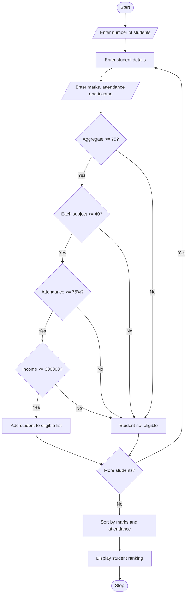

# 1. University Scholarship Allocation

## 1. Problem Statement

Design a Python program to allocate university scholarships based on students' aggregate marks, subject-wise minimum marks, attendance percentage, and annual family income.

The program should identify eligible students, rank them according to aggregate marks, and resolve ties using attendance percentage. Students who satisfy all the eligibility conditions will be selected for the scholarship.

## 2. Algorithm

1. Start the program.
2. Read the number of students.
3. Enter each student's name.
4. Read aggregate marks.
5. Read marks in three subjects.
6. Read attendance percentage.
7. Read annual family income.
8. Check the eligibility conditions:
   - Aggregate marks must be at least 75.
   - Each subject mark must be at least 40.
   - Attendance must be at least 75%.
   - Annual family income must not exceed ₹3,00,000.
9. Add eligible students to the list.
10. Sort eligible students based on aggregate marks.
11. If aggregate marks are equal, rank the student with higher attendance first.
12. Display the eligible students with their ranks.
13. Stop the program.

## 3. Flowchart


```
## 4. Python Source Code

```

```
## 5. Sample Output

```
Enter number of students: 3

Enter details of student 1
Enter student name: Nayana
Enter aggregate marks: 90
Enter subject 1 marks: 85
Enter subject 2 marks: 90
Enter subject 3 marks: 88
Enter attendance percentage: 95
Enter annual family income: 200000

Enter details of student 2
Enter student name: Priya
Enter aggregate marks: 85
Enter subject 1 marks: 80
Enter subject 2 marks: 85
Enter subject 3 marks: 90
Enter attendance percentage: 90
Enter annual family income: 250000

Enter details of student 3
Enter student name: Rahul
Enter aggregate marks: 60
Enter subject 1 marks: 50
Enter subject 2 marks: 55
Enter subject 3 marks: 60
Enter attendance percentage: 80
Enter annual family income: 200000

--- SCHOLARSHIP ELIGIBLE STUDENTS ---

Rank: 1
Name: Nayana
Aggregate Marks: 90
Attendance: 95.0

Rank: 2
Name: Priya
Aggregate Marks: 85
Attendance: 90.0

Scholarship Allocation Completed!
```

