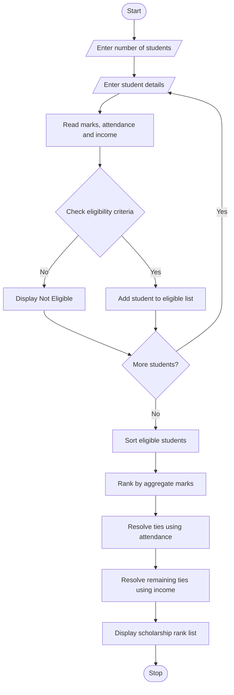

# 1. University Scholarship Allocation – Python Program

### 1. Problem Statement

Design a University Scholarship Allocation System that evaluates students based on aggregate marks, subject-wise minimum scores, attendance percentage, and annual family income. The system should identify eligible students, rank them based on academic performance, and resolve ties using predefined rules.

### 2. Algorithm

1. Start the program.
2. Enter the number of students.
3. Enter each student's name and details.
4. Read aggregate marks, Mathematics, Physics, Chemistry marks, attendance, and family income.
5. Check eligibility using the following conditions:
   - Aggregate marks must be at least 75%.
   - Each subject mark must be at least 60%.
   - Attendance must be at least 75%.
   - Annual family income must not exceed ₹2,50,000.
6. Store eligible students.
7. Rank eligible students based on aggregate marks.
8. If aggregate marks are equal, give priority to higher attendance.
9. If attendance is also equal, give priority to lower family income.
10. Display the ranked scholarship list.
11. Stop the program.

### 3. Flowchart

### 5. Sample Input

```
Enter number of students: 3

Enter details of Student 1
Enter student name: Ravi
Enter aggregate marks: 92
Enter Mathematics marks: 95
Enter Physics marks: 90
Enter Chemistry marks: 88
Enter attendance percentage: 95
Enter annual family income: 150000

Enter details of Student 2
Enter student name: Priya
Enter aggregate marks: 95
Enter Mathematics marks: 98
Enter Physics marks: 94
Enter Chemistry marks: 93
Enter attendance percentage: 98
Enter annual family income: 120000

Enter details of Student 3
Enter student name: Arun
Enter aggregate marks: 85
Enter Mathematics marks: 80
Enter Physics marks: 82
Enter Chemistry marks: 85
Enter attendance percentage: 90
Enter annual family income: 200000
```

### 6. Sample Output

```
Ravi is Eligible for Scholarship
Priya is Eligible for Scholarship
Arun is Eligible for Scholarship

----- SCHOLARSHIP RANK LIST -----

Rank: 1
Name: Priya
Aggregate Marks: 95.0
Attendance: 98.0
Family Income: 120000.0

Rank: 2
Name: Ravi
Aggregate Marks: 92.0
Attendance: 95.0
Family Income: 150000.0

Rank: 3
Name: Arun
Aggregate Marks: 85.0
Attendance: 90.0
Family Income: 200000.0

Total Eligible Students: 3
```


