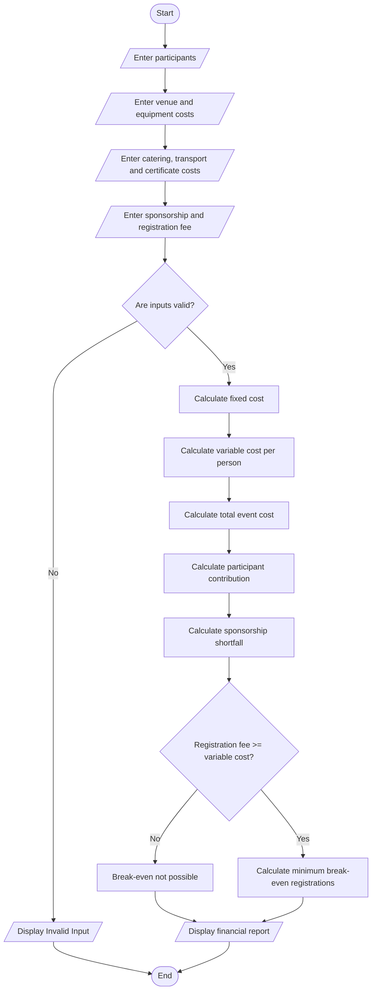

# 10. Campus Event Financial Planning

## 1. Problem Statement

Develop a Python program to calculate the total expenses for organizing a campus event, including venue, equipment, catering, transport, and certificate costs. Calculate the amount each participant must contribute, determine the sponsorship shortfall, and find the minimum number of registrations required to break even.

## 2. Algorithm

1. Start the program.
2. Read the number of expected participants.
3. Enter venue, equipment, catering per person, transport per person, and certificate per person costs.
4. Enter the available sponsorship amount and registration fee per participant.
5. Calculate fixed costs (venue + equipment).
6. Calculate variable costs (catering + transport + certificates) per participant.
7. Calculate the total event cost.
8. Calculate the contribution required per participant.
9. Calculate the sponsorship shortfall, if any.
10. Calculate the minimum registrations required to break even.
11. Display all financial details.
12. Stop the program.

## 3. Flowchart

## 5. Sample Input

```
Enter number of participants: 100
Enter venue cost: 10000
Enter equipment cost: 5000
Enter catering cost per person: 150
Enter transport cost per person: 50
Enter certificate cost per person: 20
Enter available sponsorship amount: 10000
Enter registration fee per person: 300
```

## 6. Sample Output

```
----- CAMPUS EVENT FINANCIAL REPORT -----

Fixed Cost: 15000.0
Variable Cost per Person: 220.0
Total Event Cost: 37000.0

Contribution per Participant: 370.0
Sponsorship Shortfall: 27000.0
Minimum Registrations Required: 90

-----------------------------------------
```

