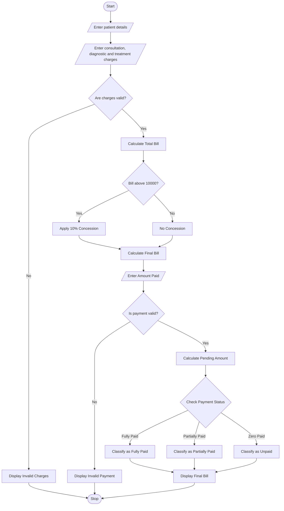

# 3. Hospital Billing and Patient Classification – Python Program

### 1. Problem Statement

Develop a Hospital Billing and Patient Classification System using Python. The program should calculate patient bills based on consultation charges, diagnostic charges, and treatment charges. It should apply conditional concessions, validate billing constraints, calculate the final bill, and classify patients according to their payment status.

### 2. Algorithm

1. Start the program.
2. Enter the patient's name.
3. Enter consultation, diagnostic, and treatment charges.
4. Validate that all charges are non-negative.
5. Calculate the total bill.
6. Apply a 10% concession if the total bill is above ₹10,000.
7. Calculate the final bill after concession.
8. Enter the amount paid by the patient.
9. Validate that the paid amount is not negative or greater than the final bill.
10. Calculate the pending amount.
11. Classify the patient:
    - Fully Paid – If the entire bill is paid.
    - Partially Paid – If some amount is paid.
    - Unpaid – If no amount is paid.
12. Display the complete bill details.
13. Stop the program.

### 3. Flowchart

### 5. Sample Input

```
===== HOSPITAL BILLING SYSTEM =====

Enter patient name: Rahul
Enter consultation charges: 1000
Enter diagnostic charges: 3000
Enter treatment charges: 8000
Enter amount paid: 5000
```

### 6. Sample Output

```
===== HOSPITAL BILLING SYSTEM =====

Total Bill: Rs. 12000.0
Concession: Rs. 1200.0
Final Bill: Rs. 10800.0

===== PATIENT BILL DETAILS =====

Patient Name: Rahul
Consultation Charges: Rs. 1000.0
Diagnostic Charges: Rs. 3000.0
Treatment Charges: Rs. 8000.0
Total Bill: Rs. 12000.0
Concession: Rs. 1200.0
Final Bill: Rs. 10800.0
Amount Paid: Rs. 5000.0
Pending Amount: Rs. 5800.0
Patient Classification: Partially Paid

Thank You!
```

