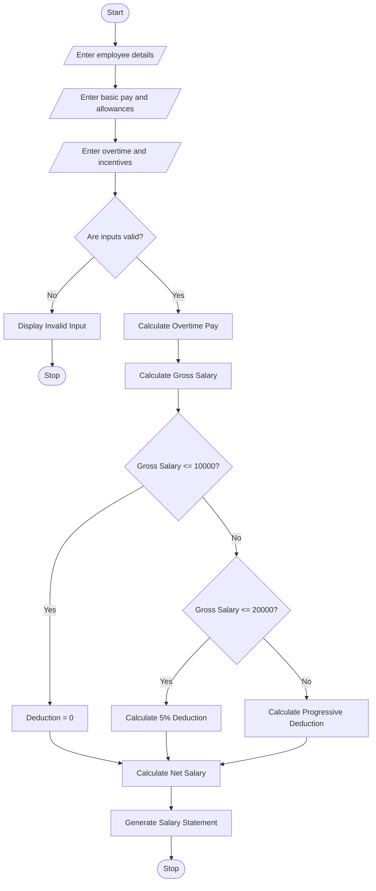

# 4. Employee Payroll and Deduction Analysis – Python Program

### 1. Problem Statement

Develop an Employee Payroll and Deduction Analysis System using Python. The program should calculate gross salary based on basic pay, allowances, overtime, and incentives. It should apply progressive deductions based on salary slabs and generate a formatted salary statement showing gross salary, deductions, and net salary.

### 2. Algorithm

1. Start the program.
2. Enter employee name and employee ID.
3. Enter basic salary.
4. Enter allowances, overtime hours, overtime rate, and incentives.
5. Calculate overtime pay.
6. Calculate gross salary by adding basic pay, allowances, overtime pay, and incentives.
7. Apply progressive deductions:
   - First ₹10,000: No deduction.
   - Next ₹10,000: 5% deduction.
   - Above ₹20,000: 10% deduction.
8. Calculate total deductions.
9. Calculate net salary by subtracting deductions from gross salary.
10. Display the formatted salary statement.
11. Stop the program.

### 3. Flowchart

### 5. Sample Input

```
===== EMPLOYEE PAYROLL SYSTEM =====

Enter employee name: Rahul
Enter employee ID: EMP101
Enter basic salary: 20000
Enter allowances: 5000
Enter overtime hours: 10
Enter overtime rate: 200
Enter incentives: 3000
```

### 6. Sample Output

```
===== SALARY STATEMENT =====

Employee Name: Rahul
Employee ID: EMP101
--------------------------------
Basic Salary: Rs. 20000.0
Allowances: Rs. 5000.0
Overtime Pay: Rs. 2000.0
Incentives: Rs. 3000.0
--------------------------------
Gross Salary: Rs. 30000.0
Total Deductions: Rs. 1500.0
--------------------------------
Net Salary: Rs. 28500.0
--------------------------------
Salary Processed Successfully!
```

