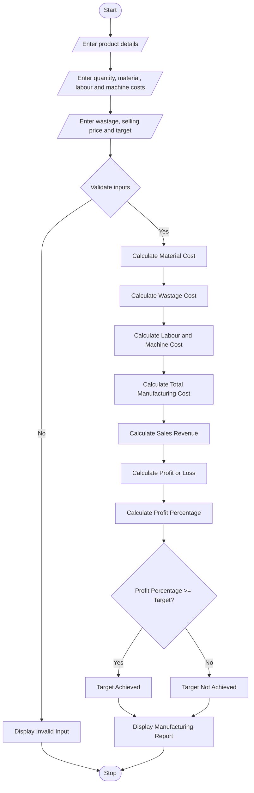

# 8. Manufacturing Cost and Profitability Analysis – Python Program

### 1. Problem Statement

Develop a Manufacturing Cost and Profitability Analysis System using Python. The program should calculate total manufacturing costs based on raw material costs, labour charges, material wastage, and machine operating costs. It should calculate the selling price, total revenue, profit or loss, and determine whether production meets the specified profit target.

### 2. Algorithm

1. Start the program.
2. Enter the product name and production quantity.
3. Enter raw material cost per unit.
4. Enter labour charges per unit.
5. Enter wastage percentage.
6. Enter machine cost per unit.
7. Enter selling price per unit.
8. Enter the expected profit target percentage.
9. Calculate total material cost.
10. Calculate wastage cost.
11. Calculate total labour cost and machine cost.
12. Calculate total manufacturing cost.
13. Calculate total sales revenue.
14. Calculate profit or loss.
15. Calculate profit percentage.
16. Compare actual profit percentage with the target.
17. Display the manufacturing cost and profitability report.
18. Stop the program.

### 3. Flowchart

### 5. Sample Input

```
===== MANUFACTURING COST ANALYSIS =====

Enter product name: Chairs
Enter production quantity: 100
Enter material cost per unit: 500
Enter labour cost per unit: 100
Enter wastage percentage: 10
Enter machine cost per unit: 50
Enter selling price per unit: 800
Enter profit target percentage: 20
```

### 6. Sample Output

```
===== MANUFACTURING REPORT =====

Product Name: Chairs
Production Quantity: 100

Material Cost: Rs. 50000.0
Wastage Cost: Rs. 5000.0
Labour Cost: Rs. 10000.0
Machine Cost: Rs. 5000.0

--------------------------------
Total Manufacturing Cost: Rs. 70000.0
Total Sales Revenue: Rs. 80000.0
Total Profit: Rs. 10000.0
Profit Percentage: 14.29 %

===== PROFIT TARGET ANALYSIS =====

Production does not meet the profit target.

Thank You!
```

