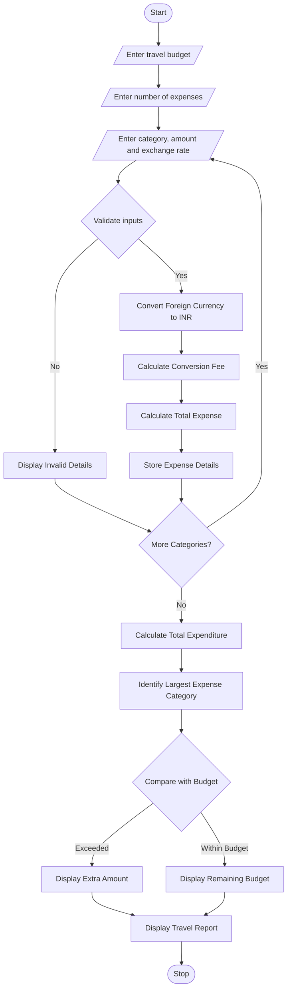

# 9. Multi-Currency Travel Budget Analysis – Python Program

### 1. Problem Statement

Develop a Multi-Currency Travel Budget Analysis System using Python. The program should calculate travel expenses in different currencies using supplied exchange rates. It should include currency conversion fees, compare total spending against the planned budget, and identify the largest expense category.

### 2. Algorithm

1. Start the program.
2. Enter the travel budget in Indian Rupees (INR).
3. Enter the number of expense categories.
4. Enter the category name and expense amount.
5. Enter the foreign currency exchange rate.
6. Convert foreign currency expenses into INR.
7. Calculate the currency conversion fee (2%).
8. Calculate the total expense including conversion fees.
9. Store all category-wise expenses.
10. Calculate total travel expenditure.
11. Compare total expenditure with the planned budget.
12. Identify the largest expense category.
13. Display the final travel budget report.
14. Stop the program.

### 3. Flowchart


### 5. Sample Input

```
===== TRAVEL BUDGET ANALYSIS SYSTEM =====

Enter travel budget in INR: 100000
Enter number of expense categories: 3

Expense Category 1
Enter expense category: Hotel
Enter expense amount in foreign currency: 200
Enter exchange rate to INR: 85

Expense Category 2
Enter expense category: Food
Enter expense amount in foreign currency: 100
Enter exchange rate to INR: 85

Expense Category 3
Enter expense category: Shopping
Enter expense amount in foreign currency: 500
Enter exchange rate to INR: 85
```

### 6. Sample Output

```
===== TRAVEL BUDGET ANALYSIS SYSTEM =====

Expense Category 1
Converted Amount: Rs. 17000.0
Conversion Fee: Rs. 340.0
Total Expense: Rs. 17340.0

Expense Category 2
Converted Amount: Rs. 8500.0
Conversion Fee: Rs. 170.0
Total Expense: Rs. 8670.0

Expense Category 3
Converted Amount: Rs. 42500.0
Conversion Fee: Rs. 850.0
Total Expense: Rs. 43350.0

===== TRAVEL EXPENSE REPORT =====

Category-wise Expenses:

Hotel: Rs. 17340.0
Food: Rs. 8670.0
Shopping: Rs. 43350.0

Total Travel Expense: Rs. 69360.0

Largest Expense Category: Shopping
Largest Expense Amount: Rs. 43350.0

===== BUDGET ANALYSIS =====

Travel is Within Budget.
Remaining Budget: Rs. 30640.0

Thank You!
```


